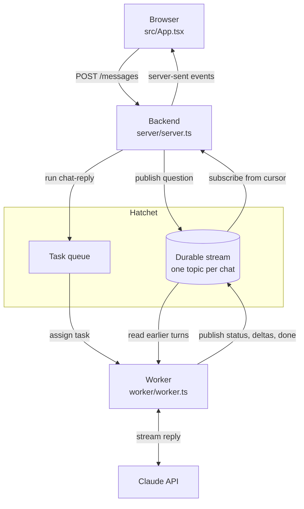

# Streams Chat

A chatbot built on Hatchet [durable streams](https://docs.hatchet.run/v1/durable-streams).

Each conversation is one stream topic. The topic holds every event in the conversation, so it is the conversation's
history as well as its live feed.



1. **The browser** posts the question to the backend (`src/App.tsx`), which publishes it to the topic and
   [runs](https://docs.hatchet.run/v1/running-your-task) the `chat-reply` [task](https://docs.hatchet.run/v1/tasks)
   without waiting for it (`server/server.ts`):

   ```ts
   await hatchet.streams.publish(topic, JSON.stringify({ type: 'user', turnId, text }));
   await hatchet.runNoWait('chat-reply', { topic, turnId, message: text }, {});
   ```

2. **The [worker](https://docs.hatchet.run/v1/workers)** runs `chat-reply`: it reads the topic back for the earlier
   turns, streams a reply from Claude, and publishes it to the same topic as it goes: a "Thinking…" status, then each
   text delta, then `done` (`worker/worker.ts`):

   ```ts
   await publish({ type: 'delta', turnId, text: event.delta.text });
   ```

3. **The backend** subscribes to the topic and relays it to the browser as server-sent events, with each event's
   cursor as its SSE id:

   ```ts
   for await (const { cursor, payload } of hatchet.streams.subscribe(topic, { cursor, signal })) { ... }
   ```

4. **The browser** folds the events into question-and-answer pairs and caches them. On a reload it shows the cache
   first and asks the backend to resume after the last cached cursor, so only newer events are read from Hatchet. If
   the connection drops, `EventSource` reconnects with the last cursor it saw.

A reload, or the same URL in another tab, shows the whole conversation, including a reply that's still being written.
The panel on the right lists the raw events and their cursors, labeled by whether each came from the browser's cache
or from Hatchet. The event shapes are in `src/events.ts`.

Only the backend and the worker hold the Hatchet token; the browser reaches Hatchet only through the backend. The
backend accepts only UUID chat ids.

## Running

You need Node 22 or later, pnpm, a Hatchet [API token](https://docs.hatchet.run/v1/api-tokens), and an Anthropic API
key. The token can come from Hatchet Cloud or a [self-hosted](https://docs.hatchet.run/self-hosting) Hatchet. Create
`.env` in the project root:

```bash
HATCHET_CLIENT_TOKEN="<your Hatchet API token>"
ANTHROPIC_API_KEY="<your Anthropic API key>"
```

Then run each of these in its own terminal:

```bash
pnpm install
pnpm worker    # terminal 1: runs chat-reply
pnpm backend   # terminal 2: the backend on :8787
pnpm dev       # terminal 3: http://localhost:5199, proxying /api to the backend
```

The worker and the backend read `HATCHET_CLIENT_TOKEN` from `.env`, and the worker reads `ANTHROPIC_API_KEY` from it
too. The page reads nothing from `.env`: Vite only exposes `VITE_*` variables to it.
